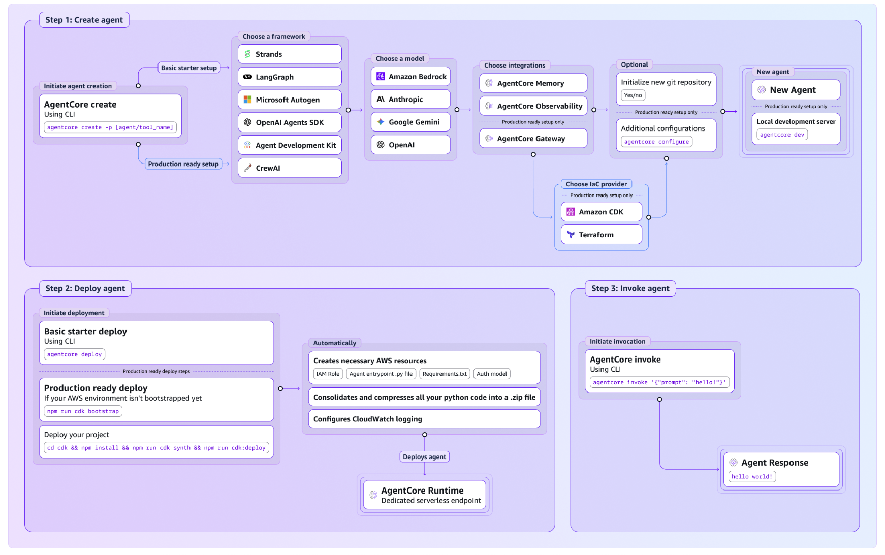

# AWS AgentCore

## Overview

Launched in July 2025, Amazon Bedrock AgentCore enables you to deploy and operate Enterprise AI agents securely, at scale. It provides a comprehensive agentic platform for building, deploying, and operating highly effective agents using any framework and foundation model.

*Source: [What is Amazon Bedrock AgentCore? — AWS Developer Guide](https://docs.aws.amazon.com/bedrock-agentcore/latest/devguide/what-is-bedrock-agentcore.html)*

## The 13 Agentic AI Capability Domains (AWS Framework)

AWS organizes the full production-ready agentic stack into 13 capability domains, each mapped to specific AWS services:

| Domain | Description | Key AWS Services |
|---|---|---|
| Agent Reasoning | Structuring the think-act-observe loop so agents decompose goals, plan steps, and act reliably | Amazon Bedrock, Amazon SageMaker AI |
| Data & Retrieval | Ingestion, transformation, and lineage pipelines feeding agents accurate enterprise knowledge through dense, sparse, hybrid, and graph-based RAG | Amazon Bedrock Knowledge Bases, Amazon OpenSearch |
| Evaluation & Experimentation | Measuring agent accuracy, faithfulness, and task completion through test suites and online metrics | Amazon Bedrock AgentCore (Evaluations), Amazon CloudWatch |
| Deployment Lifecycle | Agent versioning, prompt promotion, rollback, and evaluation-gated CI/CD | AWS CodePipeline, Amazon SageMaker AI, AWS CDK |
| Agent Routing | Classifying inputs and dispatching to the right agent, model, or workflow path based on intent, cost, and capability | Amazon EventBridge, Amazon Bedrock |
| Observability | Distributed tracing, cost tracking, latency profiling, and anomaly detection | Amazon CloudWatch, AWS X-Ray, AWS Distro for OpenTelemetry |
| Tools & Integration | Connecting agents to external systems, APIs, live data, and specialized capabilities through tools, MCP servers, and A2A protocols | AWS Lambda, Amazon API Gateway, Amazon Bedrock AgentCore (Gateway) |
| Security Hardening | Securing compute, networking, containers, and dependencies against prompt injection, secrets exposure, and AI-specific attack vectors | Amazon GuardDuty, AWS Security Hub, Amazon Inspector |
| Orchestration | Coordinating networks of specialized agents through a control plane that sequences work, manages shared context, supports HITL approval, and handles failures | AWS Step Functions, Amazon Bedrock Multi-Agent Collaboration |
| Memory | Designing short-term, long-term, and episodic memory so agents maintain continuity, share context, and learn across sessions and agent boundaries | Amazon Bedrock AgentCore (Memory), Amazon DynamoDB, Amazon ElastiCache |
| Scaling & Cost Governance | Optimizing inference capacity, latency, and GPU utilization while managing token budgets, model tiering, caching, and spend attribution | Amazon EKS, AWS Fargate, Amazon Bedrock AgentCore (Runtime) |
| Guardrails & Safety | Enforcing input/output validation, content filtering, hallucination detection, and policy compliance | Amazon Bedrock Guardrails, Amazon Bedrock AgentCore (Policy) |
| Secure Identity | Engineering agent identity distinct from user identity, with least-privilege access, credential vaulting, and full audit trails | Amazon Cognito, AWS Secrets Manager, Amazon Bedrock AgentCore (Identity) |

AWS Marketplace provides 2,800+ agentic AI tools and capabilities mapped to these 13 domains.

## Core Services

Amazon Bedrock AgentCore consists of 13 modular services that can be used together or independently. All services integrate with any open-source framework (CrewAI, LangGraph, LlamaIndex, Strands Agents, OpenAI Agents SDK, Google ADK) and any foundation model.

| Service | Description | Key Integrations |
|---|---|---|
| **Harness** | Managed agent loop — declare model, system prompt, and tools; AgentCore handles orchestration, tool execution, memory, and response generation. Each session runs in an isolated microVM with filesystem and shell access. Supports bring-your-own container, S3/EFS mounts, immutable versioning, named endpoints, and A/B rollouts. Powered by Strands Agents. | Bedrock, OpenAI, Gemini, any LiteLLM provider; AgentCore Memory, Gateway, Browser, Code Interpreter, Observability |
| **Runtime** | Secure, serverless execution environment for deploying dynamic agents and tools. Provides fast cold starts, extended async runtime, true session isolation, built-in identity, and multi-modal / multi-agent workload support. | Any open-source framework; any foundation model; MCP and A2A protocols |
| **Memory** | Short-term session memory and long-term persistent memory that survives across sessions. Extraction → Consolidation → Reflection pipeline. Three extraction tiers: Built-in (zero config), Built-in with overrides (custom prompts), Custom self-managed (external DB). Up to 365-day retention with KMS encryption. Retrieval via semantic search with metadata filters. | LangGraph, LangChain, Strands, LlamaIndex |
| **Gateway** | Converts APIs, Lambda functions, and existing services into MCP-compatible tools and connects to pre-existing MCP servers. Exposes tools to agents through governed Gateway endpoints. Used for A/B traffic splitting in Optimization. | Any API, Lambda, MCP servers; Salesforce, Zoom, JIRA, Slack and other popular SaaS integrations |
| **Identity** | Agent identity, access, and authentication management compatible with existing identity providers. Eliminates user migration. Stores sensitive credentials (wallet keys, payment secrets) securely. | Cognito, Okta, Microsoft Entra ID, Auth0 and any IdP |
| **Code Interpreter** | Isolated sandbox for agents to execute code. Improves accuracy on complex end-to-end tasks. | Python, JavaScript, TypeScript |
| **Browser** | Fully managed cloud browser runtime. Agents interact with web applications, fill forms, navigate sites, and extract information. | Playwright, BrowserUse, any foundation model |
| **Observability** | Unified trace, debug, and monitor view for production agents. Detailed step-by-step visualizations, intermediate output auditing, and performance bottleneck detection. Emits OpenTelemetry-compatible telemetry. | Any OTEL-compatible monitoring stack; Amazon CloudWatch, AWS X-Ray |
| **Payments** | Fully managed microtransaction service for agent-to-service payments using the x402 protocol and Machine Payments Protocol (MPP). Configurable per-session budget limits, stablecoin wallet integration, and 10,000+ pre-discovered x402 endpoints via Coinbase x402 Bazaar MCP server. | Coinbase CDP, Stripe (Privy) wallet providers; AgentCore Gateway, Identity, Observability |
| **Evaluations** | Purpose-built evaluation service for automated, consistent, data-driven agent assessment. Measures task execution, edge-case handling, and output reliability. Integrates Strands and LangGraph session traces instrumented via OpenTelemetry or OpenInference. | Strands Agents, LangGraph; Amazon CloudWatch |
| **Optimization** | Continuous improvement service with AI-generated recommendations, versioned configuration bundles, and A/B testing. Analyzes failure patterns from agent traces to produce optimized prompts and tool descriptions, then validates improvements with statistically significant traffic splits. | AgentCore Evaluations, Gateway (for traffic splitting); OTEL instrumentation |
| **Policy** | Deterministic guardrail layer for agents. Author fine-grained rules in natural language or Dogwood policy language (Cedar-compatible). Intercepts every tool call before execution via AgentCore Gateway to enforce which tools agents can access, what actions they can perform, and under what conditions. | AgentCore Gateway; Cedar policy language |
| **Registry (AWS Agent Registry)** | Fully managed discovery catalog for publishing, curating, and discovering MCP servers, agents, tools, skills, and custom resources across your organization. Governed approval workflow, hybrid semantic + keyword search, catalog browsing, and a native MCP endpoint. Cross-account sharing via AWS RAM; EventBridge notifications; supports IAM and JWT authorization. | Any MCP server, agent, skill, or custom resource; AWS Organizations, AWS RAM, EventBridge, CloudTrail |

### Architecture Overview

*Source: AWS Bedrock AgentCore Documentation*

Amazon Bedrock AgentCore is an agentic platform for building, deploying, and operating highly effective agents securely at scale using any framework and foundation model. With AgentCore, you can:

- Enable agents to take actions across tools and data with the right permissions and governance
- Run agents securely at scale
- Monitor agent performance and quality in production
- Operate without any infrastructure management

## Framework Compatibility

AgentCore services work together or independently with any open-source framework:

### Supported Frameworks
- **CrewAI**: Multi-agent collaboration framework
- **LangGraph**: Graph-based agent workflows
- **LlamaIndex**: Data-focused agent development
- **Strands Agents**: AWS native agent framework
- **Custom Frameworks**: Support for any framework via standard APIs

### Model Flexibility
- **Any Foundation Model**: Not limited to AWS models
- **Multi-provider Support**: OpenAI, Anthropic, Google, and others
- **Custom Models**: Support for fine-tuned and custom models
- **Model Routing**: Intelligent routing based on task requirements

## Key Capabilities by Theme

### Agent Execution
The **Harness** is the highest-level abstraction — declare a model, instructions, and tools, and AgentCore runs the full agent loop in a secure isolated microVM. Session state persists across harness restarts; memory and files survive even when the underlying microVM expires. The **Runtime** sits one level lower and is the right choice when you need to bring an existing framework (LangGraph, CrewAI, etc.) and want serverless scale without managing containers.

### Memory and Context
AgentCore **Memory** supports both in-session (short-term) and cross-session (long-term) state. The extraction pipeline runs Extraction → Consolidation → Reflection on conversation history to build durable knowledge. Three extraction modes let teams choose between fully automatic, prompt-guided, and custom-managed approaches. Retention is configurable up to 365 days with KMS encryption.

### Tool Connectivity and Policy
**Gateway** wraps any HTTP API, Lambda function, or OpenAPI spec into an MCP-compatible tool endpoint in a few lines of code. **Policy** intercepts every tool call at the Gateway layer, enforcing Cedar-compatible rules authored in natural language or the Dogwood policy language. Together they let teams grant agents broad capability while keeping deterministic guardrails on what any individual agent can actually do.

### Payments
**Payments** solves the microtransaction problem for agents: traditional payment rails impose minimum fees that make sub-dollar API calls uneconomical. AgentCore Payments uses the x402 protocol over HTTP 402 responses and the Machine Payments Protocol (MPP), managing the full transaction lifecycle (wallet credential storage via Identity, budget enforcement, signing, payment proof return). Developers can browse 10,000+ pay-per-use endpoints through the integrated Coinbase x402 Bazaar MCP server.

### Evaluation and Continuous Improvement
**Evaluations** provides automated quality scoring from agent session traces (Strands or LangGraph, instrumented via OTEL or OpenInference). **Optimization** closes the loop: it analyzes failure patterns, generates AI-recommended improvements to system prompts and tool descriptions, packages them as immutable configuration bundles, and validates them through A/B traffic splits on Gateway — all without code redeployment.

### Discovery and Governance
**Registry (AWS Agent Registry)** provides a governed catalog for the whole organization: MCP servers, agents, skills, and custom resources are published through an approval workflow, then discoverable via hybrid semantic + keyword search or a native MCP endpoint. Cross-account sharing via AWS RAM and EventBridge notifications round out enterprise-scale governance.

## Use Cases

### Enterprise Applications
- **Customer Service Automation**: Scalable customer support agents
- **Process Automation**: Streamline business processes with intelligent agents
- **Data Analysis**: Automated data processing and insights generation
- **Compliance Monitoring**: Agents for regulatory compliance and monitoring

### Technical Scenarios
- **Multi-agent Systems**: Coordinate multiple specialized agents
- **Integration Projects**: Connect agents with existing AWS services
- **Batch Processing**: Large-scale automated processing tasks
- **Real-time Decision Making**: Low-latency agent responses

## Getting Started

### Prerequisites
- AWS Account with appropriate permissions
- Bedrock service access in your region
- Understanding of your chosen agent framework

### Setup Process
1. **Enable Bedrock AgentCore** in your AWS account
2. **Configure IAM Roles** for agent permissions
3. **Set up Agent Runtime** environment
4. **Deploy Your Agent** using your preferred framework
5. **Configure Monitoring** and observability

### Best Practices
- **Security First**: Implement least-privilege access patterns
- **Monitor Everything**: Set up comprehensive monitoring from the start
- **Test at Scale**: Use AWS testing tools for load and performance testing
- **Cost Optimization**: Implement cost monitoring and optimization strategies
- **Framework Selection**: Choose frameworks based on your specific use case

## Integration with AWS Services

### Native Integrations
- **Amazon Bedrock**: Foundation model access and management
- **AWS Lambda**: Serverless function integration
- **Amazon S3**: Data storage and retrieval
- **Amazon DynamoDB**: Fast, scalable database for agent state
- **Amazon CloudWatch**: Monitoring and logging
- **AWS Step Functions**: Workflow orchestration

### Security Services
- **AWS IAM**: Identity and access management
- **AWS KMS**: Key management for encryption
- **AWS CloudTrail**: Audit logging and compliance
- **Amazon VPC**: Network isolation and security

## Pricing Model

### Cost Components
- **Runtime Costs**: Based on agent execution time and resources
- **Model Usage**: Foundation model API calls and token usage
- **Storage Costs**: Agent memory and data storage
- **Data Transfer**: Network costs for agent communications
- **Additional Services**: Costs for integrated AWS services

### Cost Optimization
- **Right-sizing**: Choose appropriate instance types for your workload
- **Reserved Capacity**: Use reserved instances for predictable workloads
- **Monitoring**: Implement cost monitoring and alerting
- **Efficient Frameworks**: Choose frameworks optimized for your use case

## Documentation and Resources

- **Official Documentation**: [AWS Bedrock AgentCore](https://docs.aws.amazon.com/bedrock-agentcore/)
- **Getting Started**: [AgentCore Developer Guide](https://docs.aws.amazon.com/bedrock-agentcore/latest/devguide/)
- **API Reference**: [AgentCore API Documentation](https://docs.aws.amazon.com/bedrock-agentcore/latest/api/)
- **Best Practices**: [AWS Agent Development Best Practices](https://docs.aws.amazon.com/prescriptive-guidance/latest/agentic-ai-frameworks/)
- **Blog Announcement**: [Introducing Amazon Bedrock AgentCore](https://aws.amazon.com/blogs/aws/introducing-amazon-bedrock-agentcore-securely-deploy-and-operate-ai-agents-at-any-scale/)
- **AWS Builder Center**: [Agentic AI Design Patterns](https://builder.aws.com/content/2qlet7NAUR02ygnurN1O74CIwTN/agentic-ai-on-aws-the-design-patterns-and-considerations) - A framework with six key components: Perception, Cognitive, Action, Learning, Collaboration, and Security

## Related Sections

- **Section 4.4**: AWS Strands Agents Framework
- **Section 11.3**: AWS Security Perspective
- **Section 14.2**: AWS Maturity Model for Generative AI
- **Section 15.1**: AWS AI Agents Marketplace

## See Also

- [Multi-Agent Systems](../Architecture/multi-agent-system.md) — Four planes, orchestration patterns, non-determinism math
- [AWS Strands Agents](../AgenticFrameworks/aws-strands.md)
- [ProductionBestPractices/deployment.md](../ProductionBestPractices/deployment.md)
- [ProductionBestPractices/security.md](../ProductionBestPractices/security.md)
- [ProductionBestPractices/observability.md](../ProductionBestPractices/observability.md)
- [Standards/agent2agent.md](../Standards/agent2agent.md)
- [Standards/mcp.md](../Standards/mcp.md)
- [AgentOps — AWS Perspective: Four-Pillar AgentOps Framework](../AgentOps/README.md)

## References

- [AWS Bedrock AgentCore Documentation — What is AgentCore?](https://docs.aws.amazon.com/bedrock-agentcore/latest/devguide/what-is-bedrock-agentcore.html) — Official overview of all 13 AgentCore services
- [AgentCore Harness](https://docs.aws.amazon.com/bedrock-agentcore/latest/devguide/harness.html) — Managed agent loop, isolated microVM sessions, versioning, and A/B rollouts
- [AgentCore Payments](https://docs.aws.amazon.com/bedrock-agentcore/latest/devguide/payments.html) — Microtransaction service using x402 and MPP protocols
- [AgentCore Optimization](https://docs.aws.amazon.com/bedrock-agentcore/latest/devguide/optimization.html) — AI-generated recommendations, configuration bundles, and A/B testing
- [AWS Agent Registry](https://docs.aws.amazon.com/bedrock-agentcore/latest/devguide/registry.html) — Governed catalog for discovering and managing agents, MCP servers, tools, and skills
- [AWS Marketplace — Building Agentic Systems: Multi-Agent Architectures (Module 4)](https://aws.amazon.com/marketplace/build-learn/ai-agent-learning-series/multi-agent-architectures) — Workshop covering the 13-domain capability stack, four planes of multi-agent systems, and AWS service mappings
- [AWS Marketplace — Building Agentic Systems: Agent Memory Systems (Module 7)](https://aws.amazon.com/marketplace/build-learn/ai-agent-learning-series/agent-memory-systems) — AgentCore Memory short-term/long-term architecture, extraction strategy tiers, partner memory stack (Redis Cloud, MongoDB Atlas, Neo4j AuraDB), memory governance
- [AgentOps: Operationalize agentic AI at scale with Amazon Bedrock AgentCore (AWS Machine Learning Blog)](https://aws.amazon.com/blogs/machine-learning/agentops-operationalize-agentic-ai-at-scale-with-amazon-bedrock-agentcore/)
- [Introducing Amazon Bedrock AgentCore (AWS Blog)](https://aws.amazon.com/blogs/aws/introducing-amazon-bedrock-agentcore-securely-deploy-and-operate-ai-agents-at-any-scale/)