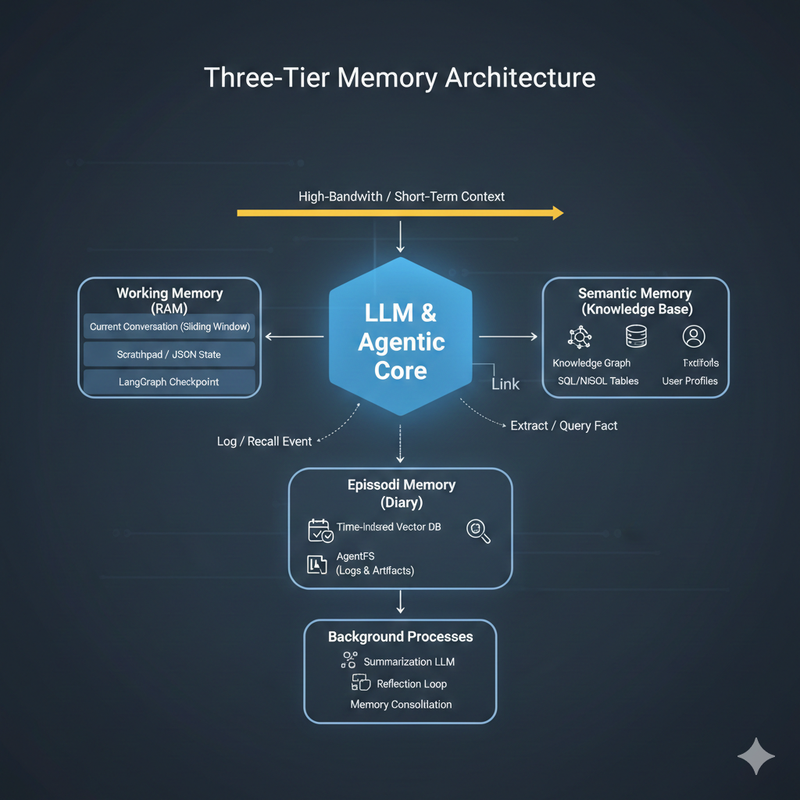

# State & Memory Management

Effective memory management determines whether an agent feels like a persistent, intelligent system or a stateless chatbot. The core challenge is deciding what to keep in the expensive context window versus what to offload to external storage.

## Overview

Agent memory operates across three functional tiers:

| Tier | Purpose | Storage | Analogy |
|---|---|---|---|
| Short-term (Working Memory) | Current task context and conversation flow | In-memory / checkpointer | RAM |
| Episodic Memory | Searchable log of past events and outcomes | Vector DB / structured logs | Journal |
| Long-term (Semantic Memory) | Persistent facts, preferences, and learned rules | Knowledge graph / SQL | Hard drive |

## Best Practices

| Key Challenge | Description | Lessons Learned & Alternatives Considered | Solution Applied |
|---|---|---|---|
| Repeated corrections disappear between coding sessions | Useful human feedback remains buried in transcripts or merged PR comments | The speaker describes a transcript-to-rule plugin as an alternative to repeatedly writing rules by hand; this is not model-weight training | Preserve review feedback and extract recurring lessons into durable rules or memories; wiki recommendation: review extracted rules before promoting them to shared policy ([Cursor workshop, 27:01–30:40 and 42:40–44:08](https://youtu.be/rnDm57Py54A?is=bkOS_zVfmSgXgxSz)) |
| Context window overflow | Long sessions exceed model token limits, causing truncation or errors | Tried increasing context window size; costs scaled quadratically | Implement sliding window or recursive summarization to compress old history |
| State loss between sessions | Agents forget user preferences and prior decisions across sessions | Stored full conversation history; retrieval became slow and noisy | Extract and persist key facts (entity extraction) to a structured store; retrieve on demand |
| Conflicting memory updates | Multiple agents writing to shared memory create inconsistencies | Used a single shared vector DB; concurrent writes caused stale reads | Implement optimistic locking or event-sourced memory with a temporal knowledge graph (Zep/Graphiti) |
| Memory retrieval relevance | Fetching too much irrelevant context degrades response quality | Retrieved top-K by embedding similarity alone; pulled in unrelated facts | Combine semantic search with metadata filters (recency, entity type, session ID) |
| Memory privacy and isolation | User A's memory leaking into User B's context | Shared embedding space across users; namespace collisions occurred | Enforce strict tenant/user namespacing in all memory stores; audit access patterns |
| Implicit vs explicit memory | Agents miss important facts not explicitly stated by users | Relied on users to say "remember this"; most didn't | Run a background extraction LLM to monitor conversations and auto-save key facts |
| Memory staleness | Stored facts become outdated as user context changes | Kept all facts indefinitely; agents acted on stale preferences | Attach TTLs to volatile facts; use temporal graphs to track how facts evolve over time. For managed platforms, use scheduled dreaming (Anthropic) to auto-purge contradicted facts between sessions |
| Working memory for tool-heavy tasks | Complex multi-step tool chains lose intermediate state | Passed all state through the context window; hit token limits | Use a scratchpad / AgentFS for intermediate tool outputs; reference by pointer in context |
| Self-improvement without retraining | Agent makes same mistakes across sessions without model fine-tuning | Manual rule updates in system prompt; engineers couldn't keep up | Use scheduled memory consolidation (dreaming) to extract recurring patterns from episodic logs and promote them to procedural memory automatically |
| Self-evaluation of agent output quality | Hard to know if agent succeeded without human review | Spot-checking a sample; missed regressions | Add an isolated grader agent (Outcomes pattern) that scores output against a plain-language rubric in a separate context window; loop until grader approves or max iterations reached |
| Scheduled/automated loops losing continuity between runs | A recurring automation (cron, `/loop`, `/goal`) has no memory of what a prior run already tried or resolved | Re-ran the same triage prompt from scratch each morning; duplicated work and re-surfaced resolved findings | Externalize loop state to a markdown file or tracker board (e.g., Linear via MCP) that records what's done and what's next — the agent forgets between runs, the repo/tracker doesn't; see [Loop Engineering](../AgentHarness/loop-engineering.md) |

## Memory Solutions Reference

| Solution | Provider | Core Technology | Key Strength |
|---|---|---|---|
| [Mem0](https://mem0.ai/) | Independent | Vector + Graph | Auto-extracts and refines user facts across sessions |
| [Zep](https://www.getzep.com/) | Independent | Temporal Knowledge Graph | Tracks how facts evolve over time |
| [AgentFS](https://github.com/tursodatabase/agentfs) | Turso | SQLite-backed virtual FS | Filesystem-like persistence in a single portable .db file |
| [Letta (MemGPT)](https://letta.com/) | Independent | Virtual Context | Self-managed RAM/disk for autonomous context swapping |
| [LangMem](https://blog.langchain.dev/langmem/) | LangChain | Managed SaaS | Deep integration with LangGraph nodes |
| Claude Managed Agents Memory + Dreaming | Anthropic | Filesystem + scheduled consolidation | First-party self-improving memory with dreaming (between-session consolidation) and outcomes (self-grading); Harvey reported 6× task completion gains |
| Bedrock Memory | AWS | Managed AWS | Enterprise scaling and compliance for Bedrock agents |

## LTM Strategy Selection

| Strategy | Best For | Storage |
|---|---|---|
| Vector RAG | Fuzzy/semantic search over large knowledge bases | Pinecone, Chroma, pgvector |
| Knowledge Graph | Relational reasoning, multi-hop questions | Neo4j, FalkorDB |
| Entity Extraction | Personalization, fixed attributes (allergies, preferences) | Postgres, Redis |
| Incremental Summary | Long-term narrative without storing every message | Markdown / text files |
| Reflection / Consolidation | Self-correction, learning from past failures | AgentFS / specialized DB |

## Stateless Agent Design for Horizontal Scaling

Since LLMs are themselves stateless, persisting memory externally is **non-negotiable** for production agents. The payoff: any agent instance can handle any request, enabling serverless horizontal scaling.

**Google Cloud pattern**: Design agent logic as a stateless, containerized service with external state — deployable on Cloud Run (auto-scaling) or Vertex AI Agent Engine.

**Key architectural choice**:
- **Vertex AI Agent Engine**: Provides a built-in, durable session and memory service. Managed, but less flexible.
- **Cloud Run + external DB**: More flexibility — integrate directly with AlloyDB or Cloud SQL. Requires managing the persistence layer yourself.

**Handling long-running tasks**: For complex jobs, use asynchronous/event-driven patterns. A service publishes a task to Pub/Sub, which triggers a Cloud Run worker for asynchronous processing. The agent stays responsive while the job runs in the background.

**Reliability for stateful tools**: When a tool call fails (network issue, transient error), agents must retry safely. This requires:
- **Idempotent tools**: Tools designed so calling them twice with the same inputs doesn't cause duplicate side effects (e.g., duplicate charges, duplicate messages). Critical for tools involving financial transactions or external writes.
- **Exponential backoff**: Automatically retry with increasing delays, giving the downstream service time to recover.

## Multi-Agent Shared State (AWS Pattern)

In multi-agent systems, agents coordinate through shared state rather than direct coupling. AWS recommends a three-tier shared state architecture:

| Tier | Store | Characteristics | Use For |
|---|---|---|---|
| Task state | Amazon DynamoDB | Single-digit ms reads, survives agent failures, full audit trail | Durable workflow execution state — every step recorded |
| Session context | Amazon ElastiCache | Sub-ms access, TTL-managed | Conversation turns + recently accessed payloads |
| Domain knowledge | Amazon Bedrock Knowledge Bases | Vector retrieval, governance-controlled, shared across all agents | No duplication of knowledge across agent instances |
| Intermediate results | Amazon S3 | Cost-effective, durable | Referenced by pointer in DynamoDB task state — never forwarded in payloads |

**Handoff payload principle**: include only what the next agent needs. Verbose payloads bloat context windows and degrade reasoning quality. Store large intermediate artifacts in S3 and pass a reference, not the content.

## Memory Governance: Lineage, Retention, PII, Right-to-Delete

Memory stores accumulate sensitive data under regulatory obligation. Governance must be built in at design time, not added retroactively.

### Data Lineage

Every memory write should emit an audit record with: `session_id`, `agent_id`, `user_id`, `timestamp`, `source_ip`. Tag all memory records with `{tenant_id, data_classification, retention_class}`.

| Store | Lineage Mechanism |
|---|---|
| All memory writes | AWS CloudTrail API records |
| Workflow state changes | Amazon DynamoDB Streams (audit replay) |
| S3 knowledge base records | Amazon S3 object metadata (document source) |

### Retention Policies by Tier

| Tier | Store | Recommended TTL | Notes |
|---|---|---|---|
| Session | Redis / ElastiCache | 24h default | Sessions older than 24h are stale; aggressive TTL frees DRAM |
| Workflow | DynamoDB | 90 days | Step Functions execution logs: 90-day retention |
| Long-term | MongoDB Atlas | Per-tenant configurable via `expireAfterSeconds` | Fields: timestamp |
| Knowledge base source docs | Amazon S3 | Glacier after 1 year, delete after 7 years | S3 Lifecycle rules |

### PII Detection and Handling

Apply Amazon Bedrock Guardrails PII filter in the consolidation Lambda before any write to long-term stores. Configurable modes: detect-and-mask vs. detect-and-block. PII types covered: name, SSN, email, credit card, IP. Use field-level encryption in MongoDB Atlas for PII-bearing fields with KMS-managed keys. Scan S3 source buckets with Amazon Macie before knowledge base sync jobs ingest documents.

### Right-to-Delete (GDPR/CCPA)

Indexed `user_id` on each memory store tier enables targeted purge without full-table scans:

| Store | Deletion Approach |
|---|---|
| MongoDB Atlas | `deleteMany({user_id: X})` via `user_id` index |
| DynamoDB | GSI on `user_id` — workflow log purge without full-table scan |
| Redis Cloud | `SCAN pattern 'session:*:{user_id}:*' + DEL` — async Lambda task triggered by deletion request |
| Amazon Bedrock Knowledge Bases | S3 object delete + sync job re-indexes to exclude deleted docs |

## Event Sourcing for Multi-Agent State Consistency (Confluent Pattern)

An alternative to a shared mutable state store: maintain state consistency across many agents through **immutable logs and event sourcing**, as described in Confluent's *A Guide to Event-Driven Design for Agents and Multi-Agent Systems* (2025). The model treats every agent interaction as input → processing → output over a durable event log rather than a database record:

- **Every event is recorded as an immutable, append-only entry** — no data loss, and a complete audit trail of how state evolved.
- **Replay-based recovery**: if an agent fails, it restores its state by replaying events from its last saved offset, rather than reconstructing state from a snapshot.
- **Parallel consumption without interference**: multiple agents can consume the same event stream independently, each tracking its own offset, enabling horizontal scaling without lock contention.

This complements the AWS three-tier shared-state model above: task state and intermediate results can be derived from (or backed by) an event log instead of, or in addition to, a row-oriented store like DynamoDB, particularly when the dominant access pattern is "what happened, in order" rather than "what is the current value."

## See Also

- [Building Your Own Software Factory](../SoftwareAIFactory/building-your-own-software-factory.md): runnable environments, isolated agents, verification, and feedback loops.
- [Context Engineering](./context-engineering.md)
- [Observability](./observability.md)
- [Deployment](./deployment.md)
- [Claude Managed Agents — Memory, Dreaming & Outcomes](../AgentPlatforms/claude-managed-agents.md)
- [Long-Term Memory Strategies](../AgentMemory/ltm-strategies.md)
- [Four Memory Types (CoALA + AWS Taxonomy)](../AgentMemory/functional-tiers.md)
- [Working Memory Management](../AgentMemory/short-term.md)
- [Event-Driven Design Patterns for Multi-Agent Systems (Confluent)](../DesignPatterns/event-driven-patterns.md)
- [Workflow Orchestration — Temporal](../WorkflowBuilders/orchestration.md)
- [Loop Engineering](../AgentHarness/loop-engineering.md) — externalized state as the "spine" of a scheduled, self-feeding agent loop
- [AI Governance — Best Practices](../AIGovernance/governance-best-practices.md)

## References

- [Building your own software factory](https://youtu.be/rnDm57Py54A?is=bkOS_zVfmSgXgxSz): Eric Zakariasson, Cursor; transcript-to-rule extraction, retained feedback, and the distinction from model-weight training.

## Four-Tier Memory Architecture for Production Agents (Pantsjoha, 2026)

*Building the Agentic Enterprise* (Packt, 2026) defines the four-tier memory hierarchy as a production design requirement, not an optional optimization.

| Key Challenge | Description | Lessons Learned & Alternatives Considered | Solution Applied |
|---|---|---|---|
| Context window as memory | Using the context window as the only state store — no session or long-term persistence | Relied on in-context history for all state; sessions reset on every new conversation | Separate working memory (context window) from session memory (Tier 2) from long-term episodic recall (Tier 3) from the immutable audit trail (Tier 4) |
| Schema migration Day 2 outage | A session schema change incompatible with in-flight sessions causes a runtime crash on first access | Changed session schema without migration path; all active sessions broke | Implement **lazy migration chains**: agents re-hydrate old session schemas on first access; store schema version in session metadata; migration scripts version-controlled with agent code |
| Graceful amnesia missing | Hydration failure (schema gap too large to bridge) causes a hard error rather than a graceful fallback | Failed hard on incompatible schemas; users lost context with no recovery | When hydration fails, load only the session summary and prompt the user to re-establish context — graceful amnesia is better than confabulation |
| Outcome without reasoning | Audit logs capture what the agent decided but not why; compliance cannot reconstruct the reasoning | Logged output responses; reasoning traces were discarded | Capture the full **reasoning trace** (tool calls, intermediate conclusions, context sources) alongside outcomes; near-miss events carry equal audit weight to actual errors |
| The forgotten deletion pipeline | PII-containing memory records accumulate without a retention or deletion policy | Created memory records at ingestion; no TTL or deletion path designed | Design the deletion pipeline at the same time as the ingestion pipeline; right-to-delete (GDPR) must traverse all four tiers |
| Long-running workflow resume failure | Agents cannot resume a paused workflow (e.g., waiting for human approval) after a restart | Stored workflow state in-memory only; restart lost all progress | Implement the **hydration/dehydration lifecycle**: serialize workflow state to durable storage on pause; reload on resume; use a session-status field (e.g., `WAITING_FOR_APPROVAL`) to distinguish resume from new-session |

### The Four-Tier Memory Hierarchy (Google ADK Mapping)

| Tier | Name | Scope | ADK Primitive | Backing Store | Use Case |
|---|---|---|---|---|---|
| **Tier 1** | Working memory | Turn-scoped | Context window | In-process | Active reasoning; current tool results |
| **Tier 2** | Session memory | Session-scoped | `SessionService` | Firestore / Redis / AlloyDB | Conversation continuity; task state across turns |
| **Tier 3** | Long-term / episodic memory | Persistent | `MemoryService` | AlloyDB / vector store | Cross-session recall; user preferences; prior outcomes |
| **Tier 4** | Audit trail | Immutable | Custom writer | Cloud Spanner / BigQuery | Compliance; decision replay; dispute resolution |

**Session-rewind capability** (recent ADK releases): operators can programmatically roll a session back to the state before a specified invocation, enabling compliance review, debugging, and re-execution with different inputs. App-level and user-level artifacts are not restored — only the session event log is rewound.

### Storage Decision Matrix

| Factor | Tier 2 (Session) | Tier 3 (LTM) | Tier 4 (Audit) |
|---|---|---|---|
| Access pattern | Low-latency reads, session TTL | Semantic retrieval, cross-session | Append-only, compliance queries |
| Mutability | Read/write | Read/write with extraction | Immutable |
| Example services | Firestore, Redis | AlloyDB + pgvector, Vertex Vector Search | Cloud Spanner, BigQuery |
| Retention | TTL (days–weeks) | Indefinite (with deletion pipeline) | Indefinite (regulatory minimum) |

- [Building the Agentic Enterprise (Pantsjoha, Packt 2026)](../SoftwareAIFactory/building-the-agentic-enterprise.md) — source for four-tier hierarchy, schema migration Day 2 pattern, graceful amnesia, hydration/dehydration lifecycle, and audit trail design
